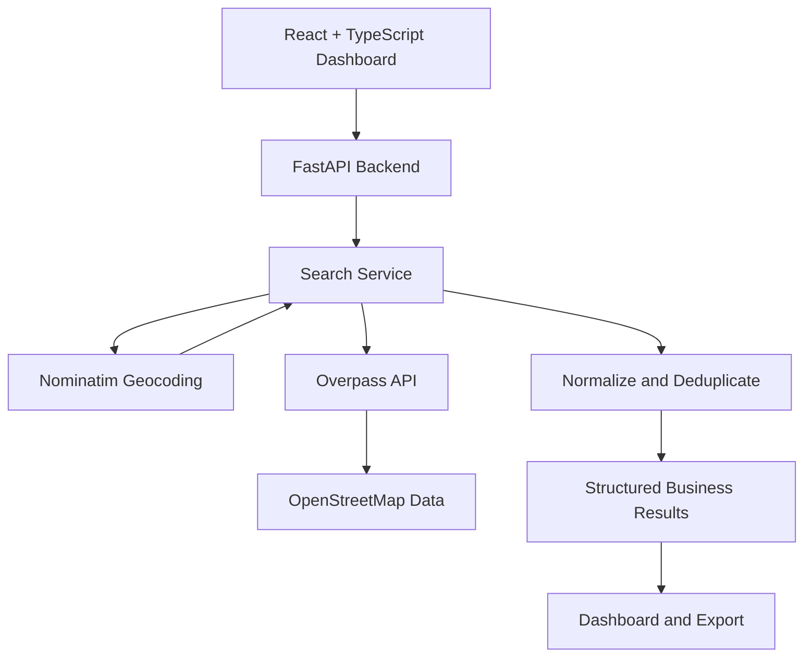

# ◈ Aveniq Data Scraper

### Open data. Smarter discovery. Zero paid API dependencies.

**A free, open-data business discovery engine built for developers, entrepreneurs, and people who want to find business leads without expensive scraping subscriptions.**

Aveniq Data Scraper uses OpenStreetMap data to discover businesses by location and category, organize available business information, and turn search results into actionable datasets.

[**Launch Web App ↗**](https://scraper-pi-one.vercel.app) · [**Report a Bug**](https://github.com/NiTrOxYT/business_data_scraper/issues) · [**Explore the Source**](https://github.com/NiTrOxYT/business_data_scraper)

---

## ◈ The idea

Business data tools can be expensive, restrictive, or difficult to customize. Aveniq Data Scraper takes a different approach: build your own workflow around open geographic data, transparent sources, and a developer-friendly stack.

Search for businesses. Inspect available information. Export results. Build your own lead-generation workflow.

**No paid API keys required for the core OpenStreetMap-based workflow. No mandatory scraping subscription. Just a tool you can run, inspect, and extend.**

> Data availability depends on OpenStreetMap coverage and the information contributed by its community. This project does not scrape Google Maps.

## ✦ Features

| Feature | Description |
|---|---|
| 🌍 Location-based discovery | Search businesses by city or location |
| 🧭 Category search | Discover businesses using supported category mappings |
| 🔎 Open-data search | Uses OpenStreetMap-based search infrastructure |
| 📋 Structured results | View available names, addresses, contact details, and coordinates |
| 📤 Data export | Export functionality provided by the application |
| ♻️ Duplicate handling | Deduplicate records using source identifiers |
| ⚡ Cache-aware searches | Reuse cached results where appropriate and support refresh |
| 🧪 Tested backend | Automated backend tests for search and data-processing behavior |
| 🌑 Dark interface | A polished, dark dashboard with an engineering-focused visual identity |
| 📱 Responsive design | Desktop dashboard and mobile navigation |
| 🧾 Source transparency | Preserve data-source attribution and distinguish unavailable fields |

*The availability of individual fields and features depends on the configured search category, source data, and deployed application version.*

## 🖥️ Interface

Aveniq uses a dark, data-engineering-inspired interface featuring:

- Obsidian surfaces and subtle glass-like borders.
- Electric indigo and cyan accents.
- Plus Jakarta Sans typography.
- JetBrains Mono for technical metadata.
- Responsive navigation, search controls, and result tables.
- Execution-run history UI and interactive data controls.

## 🏗️ Architecture



### Technology stack

- **Frontend:** React, TypeScript, Vite
- **Backend:** Python, FastAPI
- **Geographic data:** OpenStreetMap
- **Geocoding:** Nominatim
- **Geographic queries:** Overpass API
- **Testing:** pytest
- **Deployment:** Vercel for the deployed application

## 🚀 Getting started

### Requirements

- Node.js and npm
- Python 3.11 or a compatible version supported by the project
- Git
- Internet access for the public OpenStreetMap services

### 1. Clone the repository

```bash
git clone https://github.com/NiTrOxYT/business_data_scraper.git
cd business_data_scraper
```

### 2. Install frontend dependencies

```bash
npm install
```

### 3. Set up the Python environment

**Windows PowerShell:**

```powershell
python -m venv .venv
.\.venv\Scripts\Activate.ps1
```

**macOS / Linux:**

```bash
python3 -m venv .venv
source .venv/bin/activate
```

Install the backend dependencies using the dependency file included in the repository. For example, if the project uses `requirements.txt`:

```bash
pip install -r requirements.txt
```

Check the repository's backend entry point and local development instructions before starting the server.

### 4. Start the application

Run the frontend:

```bash
npm run dev
```

Run the FastAPI backend using the actual module path configured in the project. For example:

```bash
uvicorn api.index:app --reload --port 8000
```

If the frontend uses a Vite development proxy, confirm that it points to the backend port.

### 5. Run tests and build

```bash
npm run build
```

For a Windows virtual environment:

```powershell
.\.venv\Scripts\python -m pytest tests/test_backend.py -v
```

Adjust the test command if your repository uses a different test path.

## 🔍 How it works

1. Enter a location and choose a supported business category.
2. The backend resolves the location and prepares a geographic query.
3. The search service retrieves matching open-data records.
4. Results are normalized and duplicates are removed.
5. The dashboard displays the returned business information.
6. Use the available export controls to work with your results.

A missing phone number, website, or email does not necessarily mean a business record is invalid. The tool should preserve legitimate records and leave unavailable fields empty rather than inventing details.

## 🌐 Live application

**Production:** https://scraper-pi-one.vercel.app

The public website is deployed on Vercel. The frontend and backend may have different runtime limitations, and public data services may occasionally be unavailable or rate-limited.

## 🧪 Testing

The latest reported project verification included:

- **33 backend tests passed**
- **Frontend production build succeeded**
- **Git changes pushed to GitHub**
- **Vercel deployment reported as ready**
- **Mobile layout checked at a 390 × 844 viewport**

These are results from the development session's verification report; they are not a guarantee that every external API or feature will remain operational.

## ⚖️ Data sources and responsible use

Aveniq Data Scraper is built around open geographic data, not Google Maps scraping.

- OpenStreetMap data is available under the Open Data Commons Open Database License (ODbL), subject to its terms.
- Provide appropriate attribution to OpenStreetMap contributors.
- Follow the usage policies of public services such as Nominatim and Overpass.
- Avoid aggressive requests, excessive concurrency, and attempts to bypass service limits.
- Respect applicable privacy, marketing, and data-protection requirements when using business contact information.
- Verify important business details before relying on them.

References:

- [OpenStreetMap Copyright and License](https://www.openstreetmap.org/copyright)
- [Nominatim Usage Policy](https://operations.osmfoundation.org/policies/nominatim/)
- [Overpass API Documentation](https://wiki.openstreetmap.org/wiki/Overpass_API)

## 🛣️ Roadmap

Potential future improvements:

- [ ] Persistent search history using SQLite
- [ ] More category mappings and configurable search filters
- [ ] Improved pagination and multi-location search jobs
- [ ] Enhanced CSV and Excel export workflows
- [ ] Search-job diagnostics and clearer failure reporting
- [ ] Optional local OpenStreetMap dataset support
- [ ] More automated frontend integration tests
- [ ] Docker-based local deployment

Roadmap items are proposals, not claims that the features are already implemented.

## 🤝 Contributing

Ideas, bug reports, and improvements are welcome.

1. Fork the repository.
2. Create a feature branch.
3. Make a focused change.
4. Run the relevant tests and production build.
5. Open a pull request explaining the change.

Please include reproduction steps when reporting a bug.

## 📄 License

Choose and add a repository license before redistributing this project. Until a license is included, do not assume that the source code is available for unrestricted reuse.

## ◈ Built with Aveniq

**Discover locally. Structure intelligently. Build freely.**

[Launch Aveniq Data Scraper](https://scraper-pi-one.vercel.app) · [GitHub Repository](https://github.com/NiTrOxYT/business_data_scraper)
